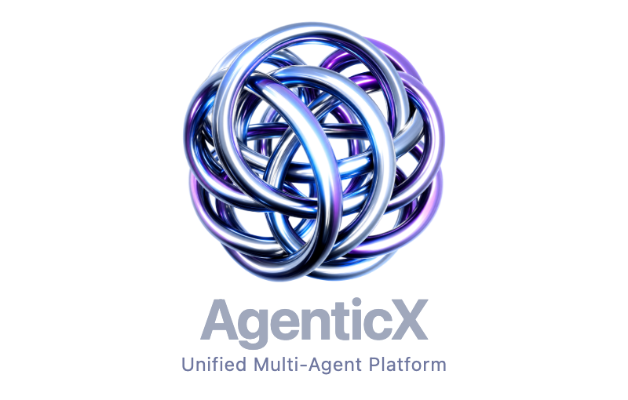

# AgenticX Workbench · AI Agent Workbench

**English** · [简体中文](README_ZN.md)

  
  
<strong>An open-source agent runtime, local-first desktop workspace, and enterprise control plane in one codebase.</strong>

  
  
  
  

When building agent applications, you usually end up stitching together three separate pieces: a Python runtime for tool loops and document parsing, a local desktop UI for day-to-day multi-agent workspaces, and a gateway/control plane when teams need auth, quotas, and audit logs.

**AgenticX Workbench** brings those three surfaces together in a single preview distribution built on [AgenticX](https://github.com/DemonDamon/AgenticX) (by Ziran Li and contributors, Apache-2.0):

- **If you want to embed agents in code**, start with the [Python quick start](#quick-start) (`agenticx/`).
- **If you want a local-first desktop workspace**, jump to [Ontology Desktop](desktop/README.md) (`desktop/`).
- **If you are exploring team governance, RBAC, and Go gateway routing**, see [AgenticX Enterprise](enterprise/README.md) (`enterprise/`).

> **Status note:** The Python SDK and core runtime are the most mature entry points. Desktop and Enterprise are active preview surfaces where packaging, connector execution, and workflow editors continue to evolve.

## What is included

| Directory | Purpose |
| --- | --- |
| agenticx/ | Python SDK, Agent Runtime, Studio server, CLI, tools, memory, knowledge, protocols, and safety primitives |
| desktop/ | Electron + React local-first desktop application |
| enterprise/ | Web Portal, Admin Console, Go AI Gateway, IAM/RBAC, policy, metering, audit, and deployment files |
| examples/ | Small runnable examples for agents, tools, retrieval, documents, and integrations |
| docs/ | Concepts, installation, CLI, API, security, and operational guides |
| packaging/ | Scripts for self-contained desktop backends and installers |

The three product surfaces share the same agent and tool abstractions, while their deployment paths stay separate:

- **Python Runtime** is the foundation for embedding AgenticX in your own service or script.
- **Ontology Desktop** is a local-first workspace for conversations, multi-agent collaboration, files, document artifacts, MCP, Skills, and optional enterprise connectivity.
- **AgenticX Enterprise** provides the shared web entry point and control plane: portal, administration, gateway, identity, roles, quotas, policy, and audit.

## Core capabilities

- **Agents and ReAct execution:** typed Agent, Task, Tool, and ReAct primitives with streaming events, multi-turn history, parallel tool calls, retries, and context offloading.
- **Multi-agent collaboration:** Meta-Agent routing, delegated workers, avatar and group-chat abstractions, concurrency limits, and session isolation.
- **Workflow foundations:** graph and Flow orchestration, conditional routing, parallel branches, runtime traces, and human approval hooks.
- **Tools and connectors:** function tools, MCP Hub, OpenAPI toolsets, remote tools, document routers, Skills, and A2A interoperability.
- **Memory and knowledge:** workspace memory, persistent session scratchpads, chunking and retrieval, vector/BM25/graph retrieval, and GraphRAG building blocks.
- **Documents and artifacts:** parsers and generators for common document workflows, with workspace-scoped artifact handling and preview support in the desktop experience.
- **Safety and governance:** secret-leak detection, prompt-injection checks, command guardrails, workspace isolation, approval gates, policy evaluation, and audit events.
- **Models and operations:** OpenAI-compatible and provider-specific adapters, fallback routing, token accounting, metrics, tracing, and evaluation utilities.
- **Extension catalog:** local bundles for Skills, MCP servers, avatars, and memory templates, with optional marketplace discovery.

### Workflow and approvals

The current workflow stack is deliberately high level. A workflow can describe agent work, connector actions, decisions, reviews, and approval gates without hard-coding every tool call. Published definitions can be versioned and inspected alongside runtime traces. Connector execution and ERP adapters are active development areas, so treat the workflow editor as an evolving foundation rather than a finished low-code product.

## Quick start

### 1. Install the Python runtime

Requirements: Python 3.10 or newer and pip or uv. The `agenticx` package below is the upstream Python runtime; use the source checkout to install this Ontology distribution.

~~~bash
python -m venv .venv
source .venv/bin/activate
python -m pip install --upgrade pip
pip install agenticx
~~~

For a source checkout:

~~~bash
git clone https://github.com/dubianche123/agenticx-agent-workbench.git
cd agenticx-agent-workbench
pip install -e .
~~~

Install optional capability groups only when needed:

~~~bash
pip install -e ".[desktop-runtime]"   # local desktop backend, PDF/Office parsing, MCP
pip install -e ".[memory]"            # vector and memory backends
pip install -e ".[document]"          # document parsing and OCR helpers
pip install -e ".[all]"               # all runtime extras
~~~

Configure at least one model provider in your environment. For example:

~~~bash
export OPENAI_API_KEY="your-api-key"
agx --version
~~~

Example files contain placeholders only. Keep real credentials in environment variables or a secret manager.

### 2. Run a first agent

~~~python
from agenticx import Agent, Task, AgentExecutor
from agenticx.llms import OpenAIProvider

agent = Agent(
    id="research-agent",
    name="Research Assistant",
    role="Information gatherer",
    goal="Find and synthesize information clearly",
    organization_id="example-org",
)

task = Task(
    id="research-task",
    description="Summarize the main ideas in multi-agent systems.",
    expected_output="A concise, structured report",
)

executor = AgentExecutor(
    agent=agent,
    llm=OpenAIProvider(model="gpt-4o"),
)
result = executor.run(task)
print(result)
~~~

For a tool-enabled example, see docs/guides/first-agent.md. For a quick CLI scaffold:

~~~bash
agx project create my-agent --template basic
cd my-agent
agx run agent.py --verbose
~~~

### 3. Start the Studio API

~~~bash
agx serve --port 8000
~~~

The Studio server exposes REST and SSE endpoints for sessions, messages, agents, tools, Skills, knowledge bases, and runtime events. See docs/guides/studio.md and docs/cli.md.

### 4. Run Ontology Desktop locally

Requirements: Node.js 20 or newer and a working AgenticX Python installation.

~~~bash
cd desktop
npm install
npm run dev
~~~

The development launcher starts the Electron renderer and connects it to a local AgenticX server. Desktop-specific packaging, offline wheelhouses, and installer commands are documented in desktop/README.md and INSTALL.md.

### 5. Run Enterprise locally

Requirements: Node.js 20 or newer, pnpm 9 or newer, Go 1.22 or newer, and Docker for the local database and Redis services.

~~~bash
cd enterprise
bash scripts/bootstrap.sh
bash scripts/start-dev.sh --ui=stream
~~~

The default local entry points are:

- Web Portal: http://localhost:3000
- Admin Console: http://localhost:3001
- Gateway health: http://localhost:8088/healthz

The bootstrap script creates local configuration and asks you to provide development credentials. Do not commit the generated .env.local or .local-secrets files.

## Choosing an entry point

| You want to… | Start here |
| --- | --- |
| Embed an agent in Python | agenticx/ and docs/getting-started/ |
| Build a tool, Skill, or MCP integration | docs/concepts/tools.md and docs/guides/extensions.md |
| Explore multi-agent sessions locally | desktop/README.md |
| Configure enterprise identity, models, roles, or quotas | enterprise/README.md |
| Design or run a workflow | docs/cli.md and the workflow tests under tests/ |
| Understand security and isolation | docs/guides/security.md and enterprise/SECURITY.md |

## Offline and self-contained packaging

Self-contained desktop builds embed the local AgenticX backend and do not need to download Python dependencies on first launch. On an online build machine, prepare a wheelhouse and copy it with the installer when the target machine is offline. See INSTALL.md for the offline flow.

Common build entry points:

~~~bash
./packaging/build_dmg.sh arm64
./packaging/build_dmg.sh x64
~~~

Windows packaging is documented in desktop/README.md and packaging/build_windows_installer.ps1. Code signing and notarization require credentials supplied by the distributor; none are stored in this repository.

## Development and tests

Python tests:

~~~bash
python -m pytest -q
~~~

Desktop tests:

~~~bash
cd desktop
npm install
npm test
~~~

Enterprise checks:

~~~bash
cd enterprise
pnpm install
pnpm typecheck
pnpm test
~~~

Some integration tests require Docker, a configured database, or optional provider credentials. Read the relevant package README before running them.

## Documentation

- [Documentation index](docs/index.md)
- [Installation](docs/getting-started/installation.md)
- [Python quick start](docs/getting-started/quickstart.md)
- [CLI reference](docs/cli.md)
- [Agent concepts](docs/concepts/agent.md)
- [Tools and MCP](docs/concepts/tools.md)
- [Memory and retrieval](docs/concepts/memory.md)
- [Desktop guide](desktop/README.md)
- [Enterprise guide](enterprise/README.md)
- [Changelog](docs/changelog.md)
- [Roadmap](docs/roadmap.md)

## Contributing

Issues and pull requests are welcome. Please read CONTRIBUTING.md before making a change. Keep credentials, generated artifacts, local caches, and deployment-specific configuration out of commits.

## License

AgenticX Ontology is distributed under the Apache License 2.0. See [LICENSE](LICENSE).
